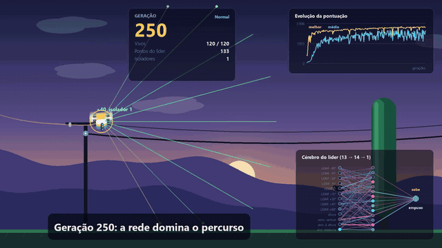

# Drone evolutivo

Drones que **aprendem sozinhos** a inspecionar uma linha de transmissão, desviando de árvores, galhos e pássaros.
Nenhuma regra de voo foi programada: o cérebro de cada drone é uma rede neural pequena (211 pesos) e quem
decide os pesos é um **algoritmo genético**. Tudo escrito do zero em Python + NumPy, sem PyTorch, sem
TensorFlow, sem biblioteca de IA.



> Inspirado no estilo dos vídeos do canal [Universo Programado](https://www.youtube.com/@UniversoProgramado),
> em que IAs aprendem a jogar jogos simples. Jogo, código, arte e áudio deste repositório são originais.

## O jogo

- O drone fica parado no eixo x da tela e o cenário rola para a esquerda, cada vez mais rápido.
- Ele controla **uma única coisa**: o empuxo (0 a 1). `0,5` paira, acima sobe, abaixo desce. Há gravidade e arrasto.
- Obstáculos: árvores altas, galhos pendurados e pássaros que voam ondulando. No **modo difícil** entram rajadas de
  vento, pássaros mais rápidos e mais velocidade.
- Missão: passar rente ao **isolador** de cada poste vale +40 pontos. Pontuação = distância ÷ 10 + 40 × isoladores.
- Bateu em qualquer coisa, no chão ou no teto: acabou.

## O cérebro

13 números entram, 1 sai:

| Entrada | Quantidade |
|---|---|
| Raios de LiDAR (−60° a +60°, de 15 em 15°), distância até a colisão | 9 |
| Altura e velocidade vertical do drone | 2 |
| Diferença de altura e distância até o próximo isolador | 2 |

`13 entradas → 14 neurônios (tanh) → 1 saída (tanh) → empuxo`. Os 211 pesos e vieses formam o **genoma**.

## O treino

1. Gera 200 genomas aleatórios.
2. Todos voam ao mesmo tempo em 4 percursos sorteados; a nota é a média dos 4.
3. Os 8 melhores passam intactos; os outros são filhos de pais escolhidos por torneio (cruzamento uniforme +
   mutação gaussiana, que diminui aos poucos); 4 recém-chegados aleatórios mantêm a variedade.
4. Repete. Cada geração roda em ~2 s (simulação vetorizada: 200 drones por passo em ~0,2 ms).

O treino salva um checkpoint **atômico** a cada geração e pode ser interrompido e retomado com o mesmo comando;
o resultado é idêntico ao de um treino sem pausa (há teste para isso).

## Resultados

Médias em 24 percursos **inéditos** (sementes que não participaram do treino nem da escolha do melhor drone),
voos de até 90 s. Reproduza com `uv run drone-report --normal runs/normal`.

**Modo normal**

| Drone | Pontos | Isoladores | Chegam aos 90 s |
|---|---|---|---|
| Só pairar (empuxo fixo em 0,5) | 148 | 0,4 | 0% (cai em 3,8 s, mediana) |
| Melhor dos 200 drones aleatórios da geração 1 (escolhido entre os 200 nos mesmos percursos) | 590 | 2,1 | 0% |
| **Melhor drone treinado no modo normal (250 gerações)** | **2.805** | **18,0** | **62%** |

**Modo difícil** (vento, pássaros mais rápidos, mais velocidade)

| Drone | Pontos | Isoladores | Chegam aos 90 s |
|---|---|---|---|
| Só pairar (empuxo fixo em 0,5) | 130 | 0,1 | 0% (cai em 2,3 s, mediana) |
| Melhor drone do modo normal, jogado no difícil | 1.760 | 10,6 | 4% |
| **Melhor drone treinado no modo difícil (+250 gerações)** | **2.436** | **12,2** | **21%** |

O modo difícil continua difícil: a adaptação ajudou bastante, mas só 1 em cada 5 voos chega aos 90 s.
Os percursos do vídeo foram escolhidos para mostrar o contraste entre as gerações; a tabela usa 24 percursos sorteados.
O treino normal leva ~10 min e o difícil outros ~10 min (6 núcleos, 4 processos em paralelo).

## Como rodar

Requer [uv](https://docs.astral.sh/uv/) e Python 3.12.

```bash
uv sync
uv run pytest                                            # testes do núcleo, renderização e áudio

# assistir (com som)
uv run drone-play --model models/best_normal.npy         # o melhor drone, modo normal
uv run drone-play --model models/best_hard.npy --hard    # o melhor drone, modo difícil
uv run drone-play --model models/best_normal.npy --human # você contra a IA (↑/↓ ou W/S)

# treinar do zero (~10 min no modo normal)
uv run drone-train --out runs/normal --gens 250 --episodes 4 --workers 4 --max-seconds 90 --seed 11
uv run drone-best runs/normal --out models/best_normal.npy      # escolhe o melhor em 24 percursos novos
uv run drone-play --run runs/normal --gen 1                     # a geração 1: o caos
uv run drone-play --run runs/normal                             # a última geração

# continuar o treino no modo difícil, a partir dos mesmos drones
uv run drone-train --out runs/hard --difficulty hard --init-from runs/normal --gens 250 --episodes 4 --workers 4 --max-seconds 90 --seed 12

# gerar o vídeo (MP4 com trilha sonora e efeitos)
uv run drone-video --normal runs/normal --hard runs/hard --out out/demo.mp4
uv run drone-gif out/demo.mp4 assets/demo.gif --start 45 --seconds 7   # GIF para o README
uv run drone-report --normal runs/normal                               # tabela de resultados
```

Teclas do visualizador: `ESPAÇO` pausa · `N`/`B` próxima/anterior geração · `H` alterna a dificuldade ·
`R` novo percurso · `M` som · `ESC` sai.

## Estrutura

| Arquivo | O que faz |
|---|---|
| `src/drone_evo/config.py` | constantes do mundo e das dificuldades |
| `src/drone_evo/world.py` | percurso (gerado por semente) e simulação vetorizada, sem pygame |
| `src/drone_evo/brain.py` | a rede neural em NumPy, para a população inteira de uma vez |
| `src/drone_evo/evolution.py` | seleção, cruzamento, mutação, checkpoints |
| `src/drone_evo/train.py` | treino sem janela, retomável, em paralelo |
| `src/drone_evo/select_best.py` | escolhe o melhor drone em percursos inéditos |
| `src/drone_evo/render.py` | cenário, LiDAR, HUD, gráfico e desenho da rede (pygame) |
| `src/drone_evo/audio.py` | efeitos, ronco do rotor e trilha, tudo sintetizado em código |
| `src/drone_evo/play.py` | visualizador ao vivo e modo humano |
| `src/drone_evo/make_video.py` | quadros direto para o ffmpeg + áudio mixado nos instantes certos |
| `src/drone_evo/make_gif.py`, `report.py` | GIF do README e tabela de resultados |

## Detalhes que deram trabalho

- **O gargalo era o sensor, não o algoritmo.** Na primeira versão (5 raios), 93% das mortes dos melhores drones que
  medi eram pássaros: um pássaro de 20 px passa entre dois raios sem ser visto. A correção foi usar 9 raios e medir a
  distância até a colisão do *corpo* do drone (obstáculos "engordados" pelo raio dele). O treino ficou bem mais rápido.
- **Percursos impossíveis escondidos.** Mesmo assim, em alguns percursos quase todos morriam no mesmo ponto: um pássaro
  derivava até o único corredor livre de uma árvore alta. Hoje os pássaros são posicionados pelo *instante* em que chegam
  ao drone e nunca fecham esse corredor; árvore seguida de galho recebe tempo calculado pela física para trocar de faixa;
  o poste sempre fica livre para a inspeção (há testes para essas garantias). Nessa mesma revisão deixei árvores e
  galhos um pouco menos extremos. A fração de voos que chega aos 90 s subiu de 38% (antes da revisão, já com os 9 raios)
  para 62%, medida em 24 percursos de cada versão do gerador. Parte desse ganho é o jogo ter ficado mais justo, não só o
  drone ter ficado melhor.
- **Seleção honesta.** O "melhor drone" não é o campeão de uma geração (que pode ter tido sorte nos 4 percursos);
  é o que tem a maior média em 24 percursos que ninguém viu durante o treino, e o relatório final usa outros 24.
- **Áudio sem direitos autorais.** Efeitos, ronco do rotor e trilha são sintetizados com NumPy
  (`uv run python -m drone_evo.audio assets/audio` grava os `.wav`).

## Licença

MIT.
